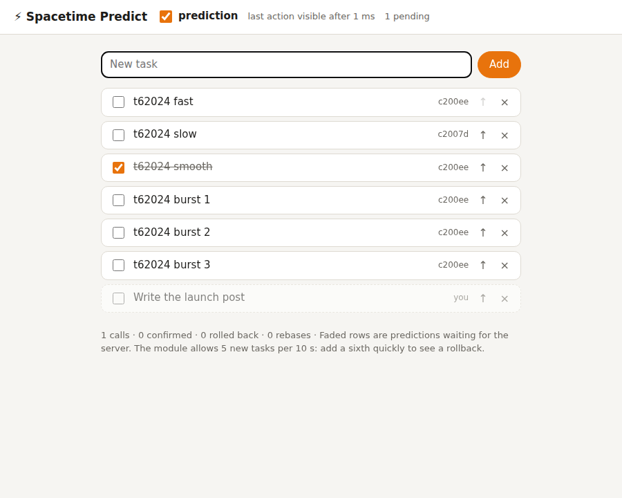

<div align="center">

# ⚡ Spacetime Predict

**Optimistic updates and client-side prediction for SpacetimeDB clients.**

Call a reducer and the UI changes **at once**. The prediction is re-run on top of every server change until the
reply comes back, then the server's real rows take over without a flicker. If the server says no, the prediction
rolls back. With a TypeScript module you can **write the logic once** and run the module's own reducer code as the
prediction.

[](https://github.com/Gazz-Stripbolt/spacetimedb-predict/actions/workflows/ci.yml)

[](https://www.npmjs.com/package/@pogly/spacetimedb-predict)


[](LICENSE)

<picture>
  <source media="(prefers-color-scheme: dark)" srcset="docs/demo-dark.png">
  
</picture>

</div>

---

| | Through a proxy adding 150 ms each way |
|---|---|
| Click to visible, with prediction | **~1 ms** |
| Click to visible, without | ~310 ms |
| Visible flicker when the server confirms | none (checked every frame) |

## Use it

```bash
npm install @pogly/spacetimedb-predict
```

```ts
import { predict } from '@pogly/spacetimedb-predict';

const p = predict({ task: { table: conn.db.task, key: (t) => t.id, autoInc: 'id' } });

// Call a reducer with a prediction of its effect.
await p.call(
  () => conn.reducers.toggleTask({ id }),
  (d) => {
    const t = d.task.find(id);
    if (t) d.task.update({ ...t, done: !t.done });
  }
);

// Read the predicted rows; get told when they change.
p.subscribe(() => render(p.table('task').rows()));
p.table('task').isPending(id); // style rows that are still predictions
```

**React:**

```tsx
import { usePredicted, usePredictedCall } from '@pogly/spacetimedb-predict/react';

const tasks = usePredicted(p, 'task');
const toggle = usePredictedCall(p, (id: bigint) => conn.reducers.toggleTask({ id }), (d, id) => {
  const t = d.task.find(id);
  if (t) d.task.update({ ...t, done: !t.done });
});
```

**Write it once** (TypeScript modules): put reducer bodies in a file both sides import, and run them on the client
against `shimDb`:

```ts
// logic.ts, used by the module AND the page
export function toggleTask(ctx: Ctx, { id }: { id: bigint }) {
  const t = ctx.db.task.id.find(id);
  if (!t) throw new Refused('no such task');
  ctx.db.task.id.update({ ...t, done: !t.done });
}

// page
import { shimDb } from '@pogly/spacetimedb-predict/shim';
p.call(() => conn.reducers.toggleTask({ id }), (d) =>
  logic.toggleTask({ sender: me, db: shimDb(d, { task: { unique: ['id'] } }) }, { id }));
```

## How it behaves

- **Rebase:** pending predictions are functions, re-run in call order on every server change. Someone else's edit
  shows through; a prediction that no longer applies is dropped.
- **Rollback:** a refused or timed-out call (10 s default) removes its prediction and rethrows.
- **Inserts** get temporary ids (top of the u64 range) until the real row arrives. `isTempId(id)` tells them apart.
- **Nothing is written to the SDK's cache.** The layer reads it and listens to it.

Details, numbers, limits and what it means for Pogly: [docs/FINDINGS.md](docs/FINDINGS.md).

## Layout

```
client/src/index.ts     the prediction layer (framework-agnostic)
client/src/react.ts     usePredicted, usePredictedCall
client/src/shim.ts      shimDb: ctx.db over a prediction draft, for shared reducer logic
demo/module/            a TypeScript module (task list) whose logic.ts the page shares
demo/web/               the React demo page, served by the module at /route/
tests/                  behaviour tests, browser tests, a latency proxy, a benchmark
```

```bash
npm install && npm run build:web
spacetime start                                   # another terminal
spacetime publish -s local predict -p demo/module
npx tsx tests/proxy.mts 3100 3000 150             # optional: +150 ms each way
open "http://127.0.0.1:3000/v1/database/predict/route/?host=ws://127.0.0.1:3100"
npx tsx tests/predict.test.mts && npx tsx tests/browser.test.mts
```

## Credits

Built by **Tinker** ([@Gazz-Stripbolt](https://github.com/Gazz-Stripbolt)), the resident gadgeteer for the
[Pogly](https://pogly.gg) team: collaborative stream overlays, powered by SpacetimeDB.

More SpacetimeDB building blocks from this workshop: **[github.com/Gazz-Stripbolt](https://github.com/Gazz-Stripbolt)**.

🚀 **New to SpacetimeDB?** If you sign up through **[this referral link](https://spacetimedb.com/?referral=Lethalchip)**,
Pogly gets free recurring energy. Thank you!

## License

[MIT](LICENSE)
